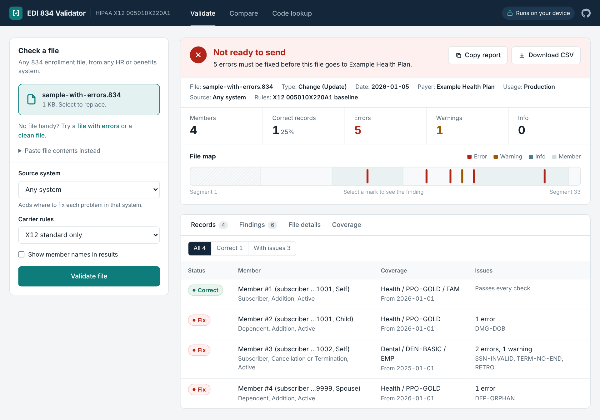

# EDI 834 MCP

Catch benefit enrollment errors before they reach the carrier.

**[Try the validator in your browser](https://hmzarshad-sys.github.io/edi-834-mcp/)**: no install, no account. Your file is checked on your own device and never uploaded.

U.S. employers send employee health, dental, vision and other benefit enrollments to insurance carriers as **HIPAA X12 834** files. When a file has errors, the carrier rejects records or enrolls people wrongly. Workers often find out at the pharmacy or the doctor's office that their coverage is missing.

This MCP server lets Claude check 834 files the way an experienced benefits integration analyst would, locally, on your machine:

- **Validate** a file against the 005010X220A1 standard and your carrier's companion-guide rules: 74 rules, each with a plain-English message and a fix.
- **Compare** this week's file with last week's to catch dropped dependents, unintended terminations and tier changes before the carrier processes them.
- **Summarize** what a file will do: adds, changes, terminations, coverage lines and tiers.
- **Explain** any 834 code (relationship, maintenance type, coverage level...).

It works with 834 files from any system: Workday, Employee Navigator, ADP, UKG, Oracle, SAP SuccessFactors or in-house payroll. For **Workday** and **Employee Navigator**, it also tells you where in that system to fix each problem, and for Workday it guides the connector setup.

## Privacy by design

834 files contain names, Social Security numbers, birth dates and addresses.

- **Runs locally.** No network calls. Files never leave your machine.
- **One folder only.** The server reads files only inside the folder you set in `EDI_834_DIR`. Paths outside it are refused.
- **Masked by default.** Results identify members as `Member #12 (subscriber …1234, Child)`. Names appear only if you ask with `show_pii`. SSNs and birth dates are never returned.
- **Read-only.** The server never edits or sends files.

See [SECURITY.md](SECURITY.md).

## Tools

| Tool | What it does |
|---|---|
| `validate_834` | Envelope, segment, element-length, header, member, address and coverage checks with rule IDs, severities, segment positions and fixes. Accepts a carrier profile. |
| `compare_834` | Differences between two files, with full-file awareness: anyone missing from a replacement file is flagged as a potential termination. |
| `summarize_834` | Counts by action, coverage line and tier, plus sender, payer, file type and date. No PII. |
| `explain_834_code` | Meaning of any code, or a whole code table. |
| `workday_834_setup_guide` | Step-by-step setup of Workday's Cloud Connect for Benefits: ANSI X12 834 V2 connector, with pitfalls. |
| `choose_workday_834_service` | Picks the right 834 V2 transmission service from the carrier's requirements. |
| `get_default_profile` | The baseline settings a carrier profile can override. |

The full rule list is in [docs/rules.md](docs/rules.md).

## Web UI

Prefer a screen to a chat? The same validator runs as a web page. Use it online at **https://hmzarshad-sys.github.io/edi-834-mcp/**, or run it yourself:



```bash
npm run ui          # opens on http://localhost:8834
```

Drop in an 834 file to validate it, compare two files, or look up a code. Every member record is listed with what the file says about it (relationship, change type, coverages and dates) and whether it is correct or has issues. It works with 834 files from any system. Pick **Workday CCB 834 V2** or **Employee Navigator** as the source system to also see where in that system to fix each finding. The page validates files in your browser: the local server only serves the page and never receives your files.

To get one self-contained HTML file you can open offline or share with your team:

```bash
npm run build:ui    # writes dist/edi-834-validator.html
```

## Install

Requires **Node.js 18+**.

```bash
git clone https://github.com/hmzarshad-sys/edi-834-mcp.git
cd edi-834-mcp
npm install
npm test
```

### Claude Code

```bash
claude mcp add edi-834 -e EDI_834_DIR="/path/to/your/834/files" -- node /absolute/path/to/edi-834-mcp/src/index.mjs
```

### Claude Desktop

Add to `claude_desktop_config.json` (`~/Library/Application Support/Claude/` on macOS, `%APPDATA%\Claude\` on Windows):

```json
{
  "mcpServers": {
    "edi-834": {
      "command": "node",
      "args": ["/absolute/path/to/edi-834-mcp/src/index.mjs"],
      "env": { "EDI_834_DIR": "/path/to/your/834/files" }
    }
  }
}
```

Restart Claude Desktop after saving.

## Use it

> "Validate outbound/acme_health_20260105.edi"

> "Compare last week's Acme file with this week's. Did anyone lose coverage?"

> "Summarize the dental file we're sending Friday"

> "What does coverage level E1D mean?"

Example finding:

```json
{
  "severity": "error",
  "rule": "TERM-NO-END",
  "segment": { "position": 41, "id": "HD" },
  "message": "Member #7 (subscriber …4821, Self), Health: termination (HD01=024) without a benefit end date (DTP*349).",
  "fix": "Send DTP*349 with the last day of coverage; without it the carrier cannot terminate correctly."
}
```

## Workday: Cloud Connect for Benefits 834 V2

If your files come from Workday's **Cloud Connect for Benefits: ANSI X12 834 V2** template:

1. **Set up the connector.**
   > "Walk me through setting up the Workday 834 V2 connector for Acme Health"

   `workday_834_setup_guide` covers the ISU and security group, the integration system, the transmission service, attributes, maps (INS02, DMG03, HD03, HD05), field attributes, population eligibility, overrides and delivery.
2. **Pick the transmission service.**
   > "Acme wants a full file every week and terminations reported once. Which service?"
3. **Test with the Debug Service.** Launch for a few test workers, download the output from the integration event into `EDI_834_DIR`, then:
   > "Validate acme_test.edi as a Workday 834 V2 file with profile profiles/acme.json"

   With `platform: "workday_ccb_834_v2"`, each finding says where to fix it:
   ```json
   {
     "rule": "HD05",
     "message": "Member #3 (subscriber …4821, Self), Health: HD05 coverage level \"EE+DP\" is not valid.",
     "where_to_fix": {
       "where": "Configure Integration Maps > Loop2300_HD05 (after Maintain Health Care Coverage Targets)",
       "how": "Map every coverage target to the carrier's code. If a target is missing from the map list, run Maintain Health Care Coverage Targets first."
     }
   }
   ```
4. **Compare runs** with `compare_834` before every send, especially with full-file services.

The full guide and fix table: [docs/workday-ccb-834-v2.md](docs/workday-ccb-834-v2.md).

## Employee Navigator

If your files come from Employee Navigator's 834 EDI configuration, validate with `platform: "employee_navigator"`:

> "Validate acme_full.edi as an Employee Navigator file"

- Each finding says where to fix it: the Setup, Plans or Fields step of the 834 EDI file, or the employee's or dependent's record.
- Employee Navigator sends full files only, so a file that is not a full file is flagged (HDR-FILE-TYPE). Anyone left out of a full file may be terminated, so run `compare_834` before every send.

The fix table: [docs/employee-navigator.md](docs/employee-navigator.md).

## Adding a source system

Each system lives in its own file under `src/` (see `src/employee-navigator.mjs`) and is registered in `src/platforms.mjs`. A system adds a fix location for every validator rule and, optionally, validation defaults. The MCP tool and the web UI pick it up automatically, and `npm test` fails if any rule has no fix location. Contributions for UKG, ADP, Oracle and SAP SuccessFactors are welcome from people who use them.

## How the 834 is structured

[docs/834-structure.md](docs/834-structure.md) maps every loop and segment of the 834 (heading, member, name, disability and coverage loops) to the rules that check it.

## Carrier profiles

Carriers publish companion guides that tighten the standard. Put their rules in a JSON file inside `EDI_834_DIR` and pass `profile_path`:

```json
{
  "name": "Acme Health companion guide v3",
  "allowed_insurance_lines": ["HLT", "DEN", "VIS"],
  "allowed_coverage_levels": ["EMP", "ESP", "ECH", "FAM"],
  "require_group_number": true,
  "require_ssn": true,
  "max_retro_days": 60,
  "max_future_days": 120,
  "dependent_age_limit": 26,
  "expected_file_type": "full"
}
```

`expected_file_type` (`"full"` or `"change"`) flags a file whose BGN08 says otherwise.

> "Validate acme_20260105.edi with profile profiles/acme.json"

See [examples/carrier-profile.example.json](examples/carrier-profile.example.json).

## Limits

- Checks the 834 structure and the business rules above. It is not a full SNIP Level 1–7 certification engine, and a clean result does not replace carrier acceptance testing.
- Code lists cover the standard 005010X220A1 values most employers use; carrier-specific codes are reported as warnings or information, not errors.
- Loop detection is built for employer-to-carrier enrollment files (one INS per member, HD loops for coverage).

## Contributing

Issues and pull requests are welcome, especially:

- carrier companion-guide rules that would make good profile options
- real-world errors the validator missed (please describe the pattern; never attach real files)

Run `npm test` before opening a PR. Every rule needs a test that fires on bad input and stays silent on a clean file.

## License

MIT. Copyright (c) 2026 Humza Arshad. See [LICENSE](LICENSE).

X12 and ASC X12 are trademarks of the Accredited Standards Committee X12. Workday is a trademark of Workday, Inc. Employee Navigator is a trademark of its owner. This project is not affiliated with or endorsed by X12, Workday or Employee Navigator.
